<a name="top"></a>
<p align="center">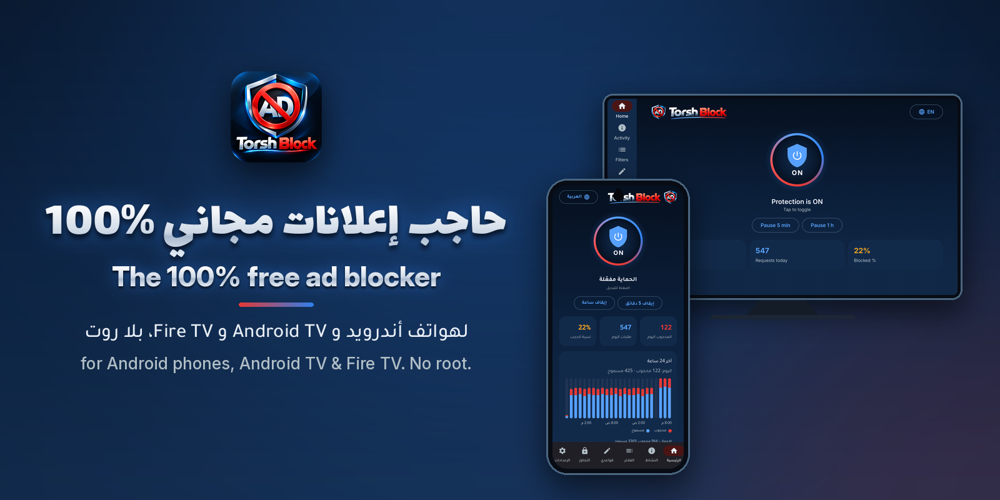</p>

<p align="center">
  <a href="https://github.com/GF0285/torsh-block/releases/latest"></a>
  <a href="https://torsh.torshblock.workers.dev"></a>
  <a href="https://torsh.torshblock.workers.dev"></a>
  <a href="https://torsh.torshblock.workers.dev"></a>
</p>

<p align="center">
  <a href="#ar"></a>
  <a href="#ary"></a>
  <a href="#en"></a>
  <a href="#es"></a>
</p>

<p align="center">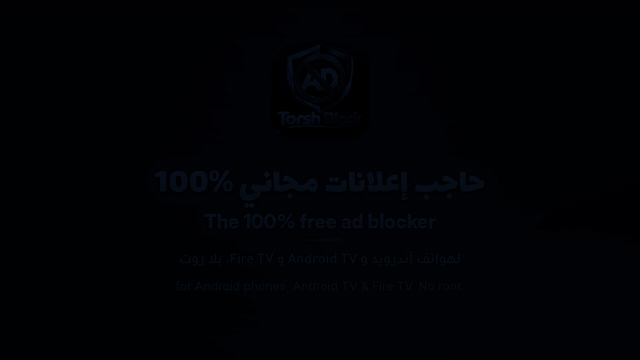<br><a href="https://github.com/GF0285/torsh-block/releases/download/v0.5.0/TorshBlock-0.5.0-demo.mp4">▶ Video 1080p</a> · <a href="https://torsh.torshblock.workers.dev">⬇ torsh.torshblock.workers.dev</a></p>

---

<a name="ar"></a>
<p align="center">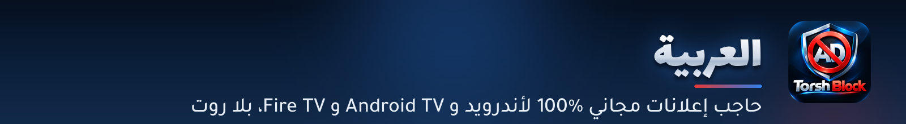</p>

<div dir="rtl" align="right">

**<span dir="ltr">Torsh Block</span>** حاجب إعلانات مجاني <span dir="ltr">100%</span> لهواتف أندرويد وأجهزة <span dir="ltr">Android TV</span> و<span dir="ltr">Fire TV</span>، بلا روت ولا حساب. يحجب الإعلانات والمتتبّعات في كل التطبيقات والمتصفحات عبر <span dir="ltr">VPN</span> محلي على جهازك.

### المزايا
- 🛡️ **حماية بلمسة واحدة** في كل التطبيقات والمتصفحات.
- 📊 **إحصائيات حيّة:** اليوم، وآخر 24 ساعة، وآخر 7 أيام.
- 🌐 **تجاوز قيود المزوّد:** <span dir="ltr">DNS</span> مشفّر (<span dir="ltr">DoH/DoT</span>) ووضع تجاوز <span dir="ltr">DPI</span>.
- 📺 **مصمَّم للتلفاز:** يعمل بجهاز التحكم عن بُعد بالكامل.
- 🗣️ **أربع لغات:** العربية، والدارجة المغربية، والإنجليزية، والإسبانية.
- 🔄 **تحديثات موقّعة** من داخل التطبيق.
- 💯 **مجاني <span dir="ltr">100%</span>:** بلا إعلانات ولا حساب ولا اشتراك.

### لقطات الشاشة

| | | |
|:-:|:-:|:-:|
| 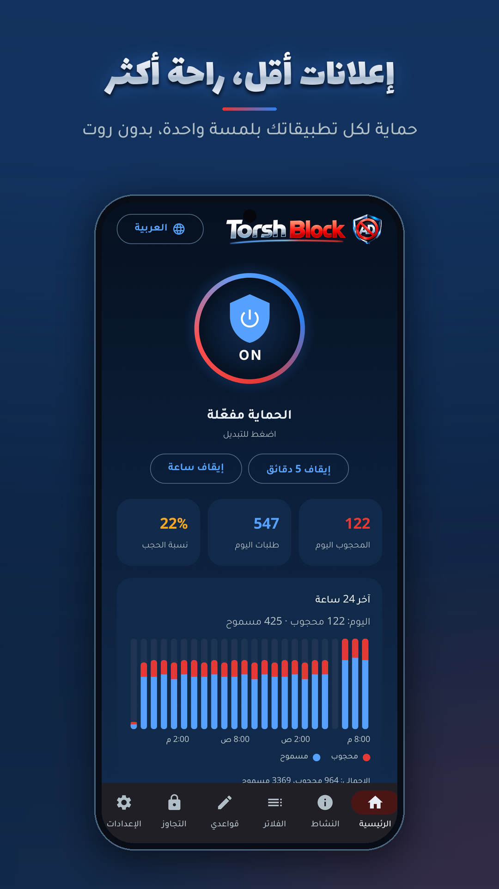 | 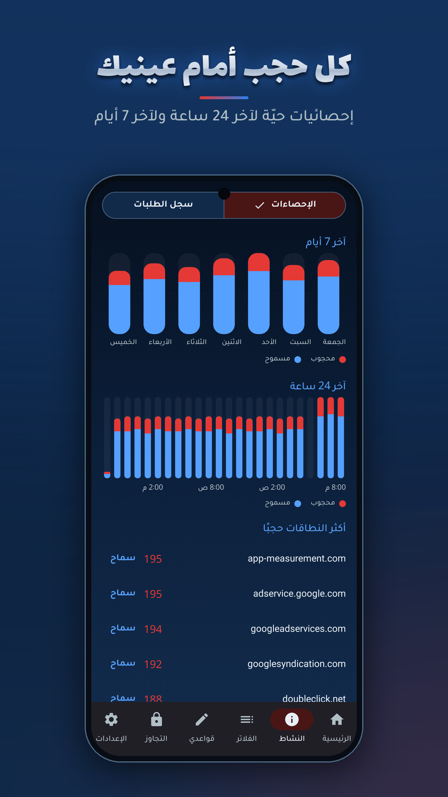 | 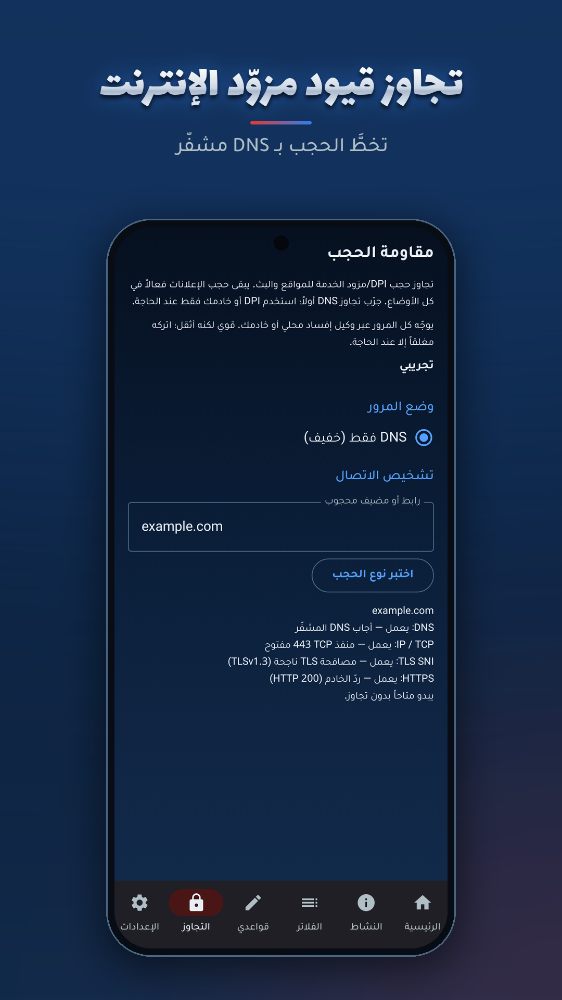 |
| 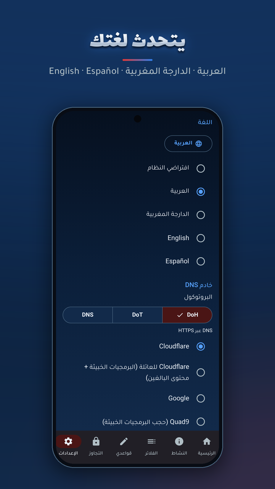 | 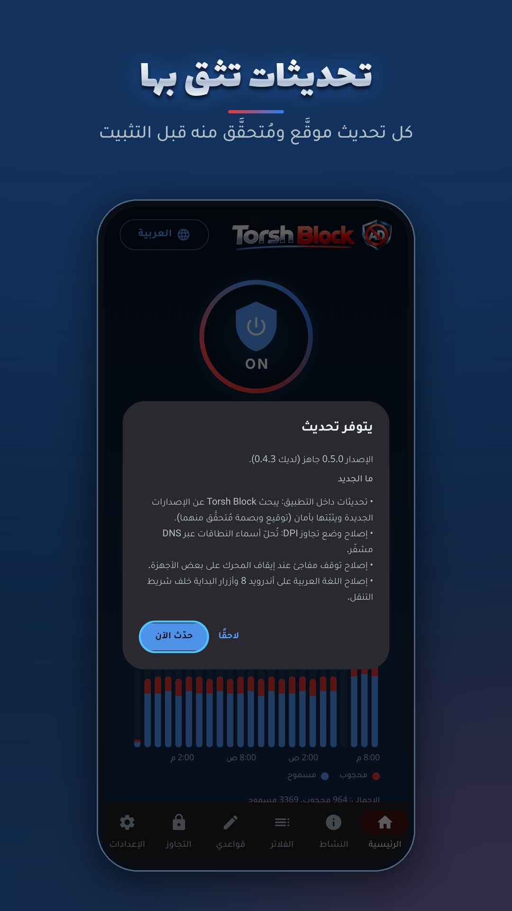 | 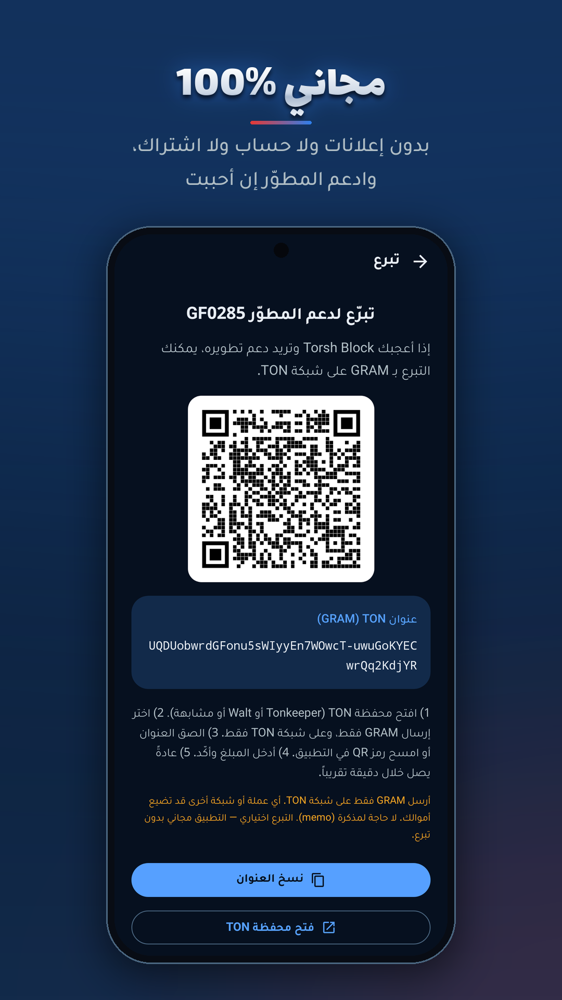 |

<p align="center">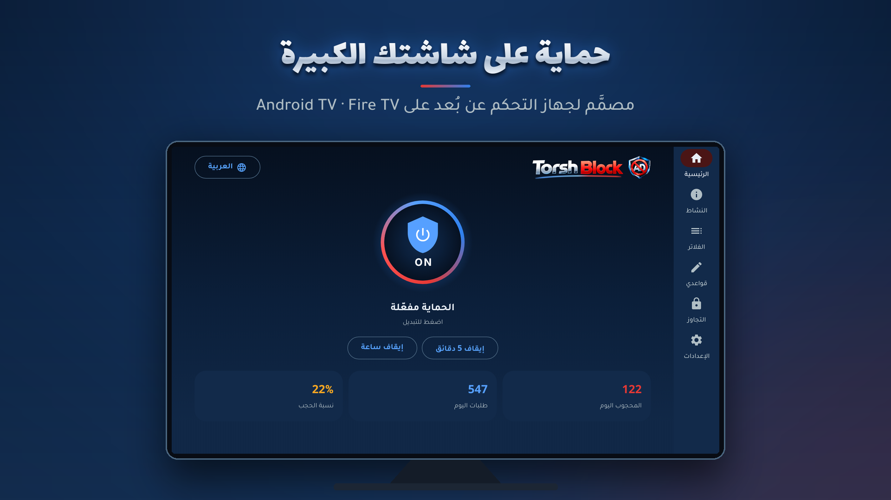</p>

### التحميل على الهاتف

افتح صفحة التحميل من هاتفك واضغط «تحميل للهاتف»، وستختار الصفحة النسخة المناسبة لجهازك تلقائيًا:

**[<span dir="ltr">torsh.torshblock.workers.dev</span>](https://torsh.torshblock.workers.dev)**

أو نزّل ملف <span dir="ltr">APK</span> من [صفحة آخر إصدار](https://github.com/GF0285/torsh-block/releases/latest).

### التثبيت على <span dir="ltr">Fire TV</span> و <span dir="ltr">Android TV</span>
1. ثبّت تطبيق <span dir="ltr">Downloader</span> من متجر أمازون.
2. فعّل «تثبيت تطبيقات غير معروفة» لتطبيق <span dir="ltr">Downloader</span>: الإعدادات ← <span dir="ltr">My Fire TV</span> ← خيارات المطوّر.
3. افتح <span dir="ltr">Downloader</span> واكتب الرمز **<span dir="ltr">2966455</span>** (أو الرابط <span dir="ltr">aftv.news/2966455</span>)، ثم اضغط <span dir="ltr">Go</span>.
4. ثبّت التطبيق، ثم فعّل الحماية بجهاز التحكم.

### ادعم المشروع

التطبيق مجاني <span dir="ltr">100%</span> وسيبقى كذلك. لدعم التطوير يمكنك التبرع بعملة <span dir="ltr">GRAM</span> على شبكة <span dir="ltr">TON</span> فقط:

<div dir="ltr" align="left">

```
UQDUobwrdGFonu5sWIyyEn7WOwcT-uwuGoKYECwrQq2KdjYR
```

</div>

<sub>برنامج مملوك © 2026 <span dir="ltr">GF0285</span>، تنزيله واستعماله مجاني. التفاصيل في [<span dir="ltr">LICENSE</span>](LICENSE).</sub>

<p align="center"><b>صُنع بـ ♥️ من طرف <span dir="ltr">GF0285</span> عضو كل من <span dir="ltr">GeeksFamily</span> و <span dir="ltr">DWM</span></b></p>

</div>

<p align="center"><a href="#top">↑</a></p>

---

<a name="ary"></a>
<p align="center">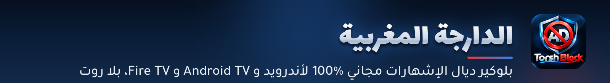</p>

<div dir="rtl" align="right">

**<span dir="ltr">Torsh Block</span>** بلوكير ديال الإشهارات مجاني <span dir="ltr">100%</span> للتيليفونات أندرويد و<span dir="ltr">Android TV</span> و<span dir="ltr">Fire TV</span>، بلا روت وبلا كونط. كيبلوكي الإشهارات والتراكورز فجميع التطبيقات والمتصفحات بواحد <span dir="ltr">VPN</span> محلي فالجهاز ديالك.

### شنو كيدير
- 🛡️ **حماية بكليكة وحدة** فجميع التطبيقات والمتصفحات.
- 📊 **إحصائيات مباشرة:** اليوم، آخر 24 ساعة وآخر 7 أيام.
- 🌐 **دوّز البلوكاج ديال الأوبيراتور:** <span dir="ltr">DNS</span> مشفّر (<span dir="ltr">DoH/DoT</span>) ومود تجاوز <span dir="ltr">DPI</span>.
- 📺 **مصاوب للتلفازة:** كيخدم بالتيليكوموند كامل.
- 🗣️ **ربعة ديال اللغات:** العربية، الدارجة، الإنجليزية والإسبانية.
- 🔄 **تحديثات موقّعة** من داخل التطبيق.
- 💯 **مجاني <span dir="ltr">100%</span>:** بلا إشهارات، بلا كونط، بلا اشتراك.

### تصاور من التطبيق

| | | |
|:-:|:-:|:-:|
|  |  |  |
|  |  |  |

<p align="center"></p>

### طيّح التطبيق فالتيليفون

حلّ صفحة التحميل من التيليفون ديالك ووركي على «طيّح للتيليفون»، والصفحة كتختار النسخة لي مناسبة لجهازك بوحدها:

**[<span dir="ltr">torsh.torshblock.workers.dev</span>](https://torsh.torshblock.workers.dev)**

ولا طيّح ملف <span dir="ltr">APK</span> من [صفحة آخر إصدار](https://github.com/GF0285/torsh-block/releases/latest).

### التثبيت فـ <span dir="ltr">Fire TV</span> و <span dir="ltr">Android TV</span>
1. طيّح تطبيق <span dir="ltr">Downloader</span> من الستور ديال أمازون.
2. عطي الإذن لـ <span dir="ltr">Downloader</span> يثبّت تطبيقات ماشي معروفة: الإعدادات ← <span dir="ltr">My Fire TV</span> ← خيارات المطوّر.
3. حلّ <span dir="ltr">Downloader</span> وكتب الرقم **<span dir="ltr">2966455</span>** (ولا الرابط <span dir="ltr">aftv.news/2966455</span>)، ومن بعد وركي على <span dir="ltr">Go</span>.
4. ثبّت التطبيق وشعّل الحماية بالتيليكوموند.

### عاون المشروع

التطبيق مجاني <span dir="ltr">100%</span> وغادي يبقى ديما مجاني. إلا بغيتي تعاون، صيفط <span dir="ltr">GRAM</span> غير على شبكة <span dir="ltr">TON</span>:

<div dir="ltr" align="left">

```
UQDUobwrdGFonu5sWIyyEn7WOwcT-uwuGoKYECwrQq2KdjYR
```

</div>

<sub>برنامج مملوك © 2026 <span dir="ltr">GF0285</span>، التحميل والاستعمال مجاني. التفاصيل فـ [<span dir="ltr">LICENSE</span>](LICENSE).</sub>

<p align="center"><b>صُنع بـ ♥️ من طرف <span dir="ltr">GF0285</span> عضو كل من <span dir="ltr">GeeksFamily</span> و <span dir="ltr">DWM</span></b></p>

</div>

<p align="center"><a href="#top">↑</a></p>

---

<a name="en"></a>
<p align="center">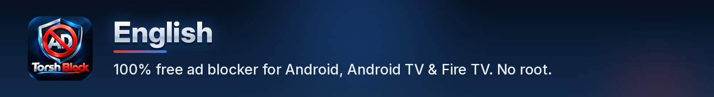</p>

**Torsh Block** is a 100% free ad blocker for Android phones, Android TV and Fire TV. No root, no account. It blocks ads and trackers in every app and browser through a local VPN on your device.

### Features
- 🛡️ **One-tap protection** in every app and browser.
- 📊 **Live stats:** today, the last 24 hours and the last 7 days.
- 🌐 **Get around ISP blocking:** encrypted DNS (DoH / DoT) and a DPI bypass mode.
- 📺 **Made for TV:** fully usable with the remote.
- 🗣️ **Four languages:** Arabic, Moroccan Darija, English and Spanish.
- 🔄 **Signed in-app updates.**
- 💯 **100% free:** no ads, no account, no subscription.

### Screenshots

| | | |
|:-:|:-:|:-:|
| 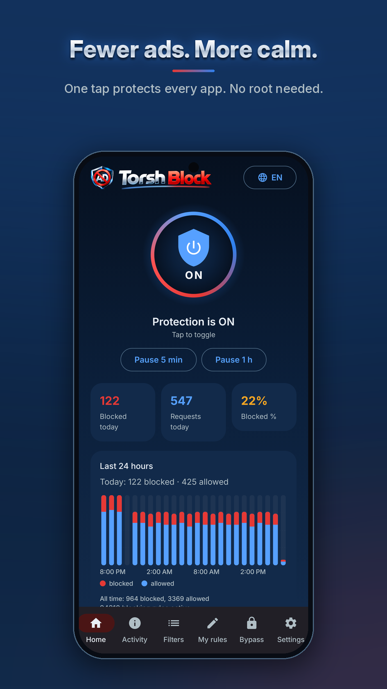 | 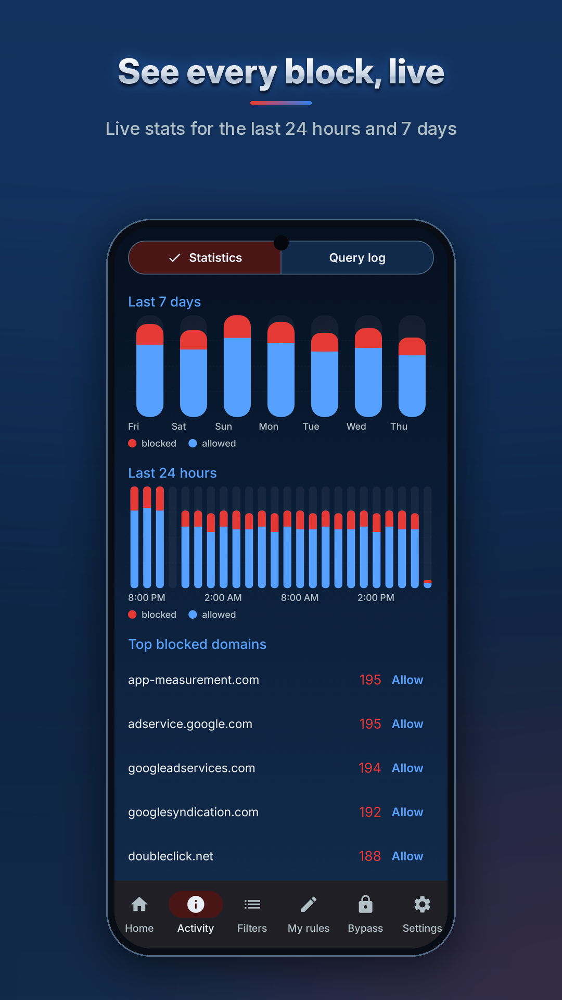 | 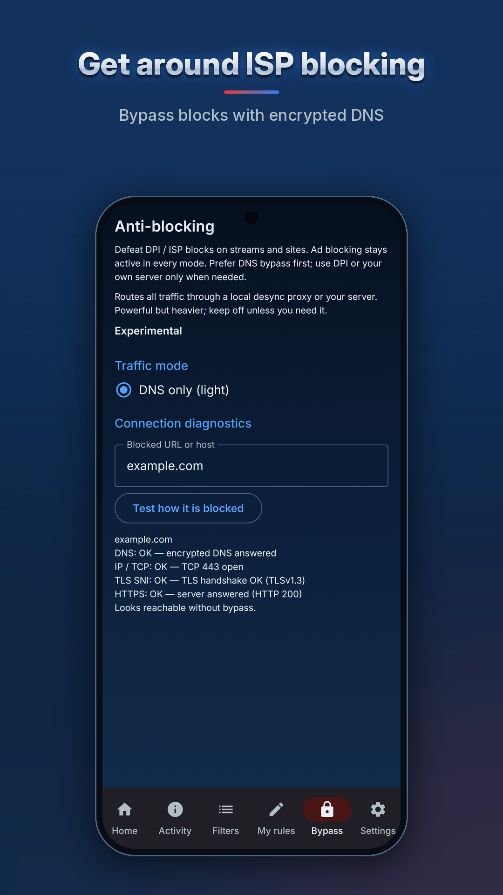 |
| 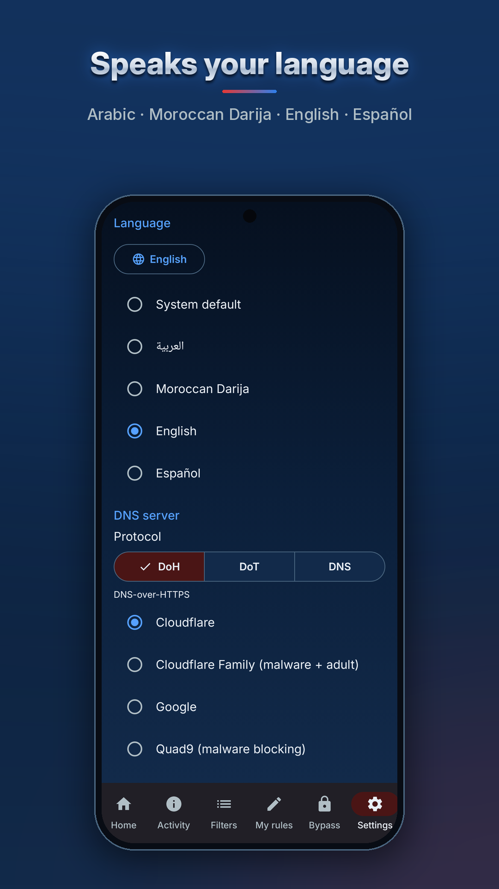 | 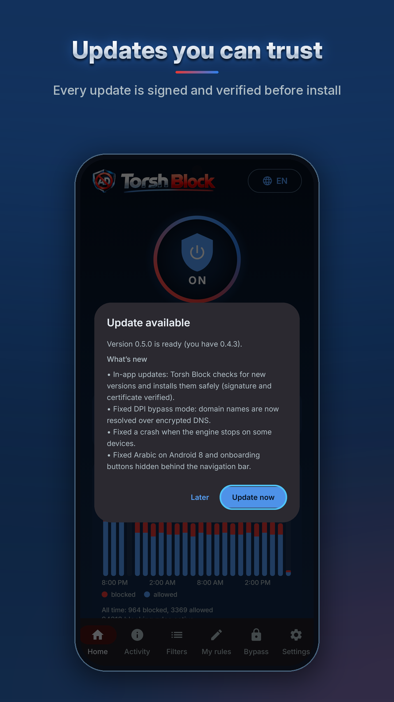 | 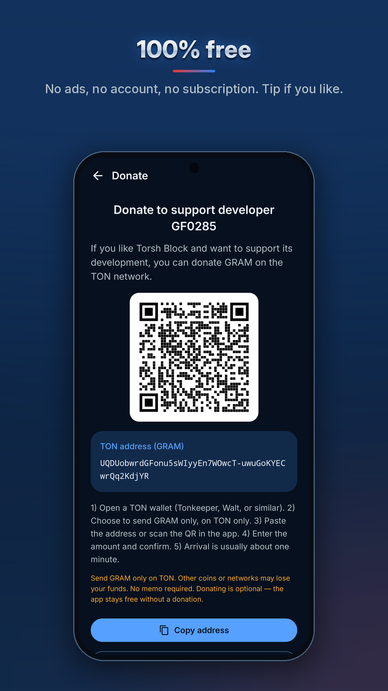 |

<p align="center">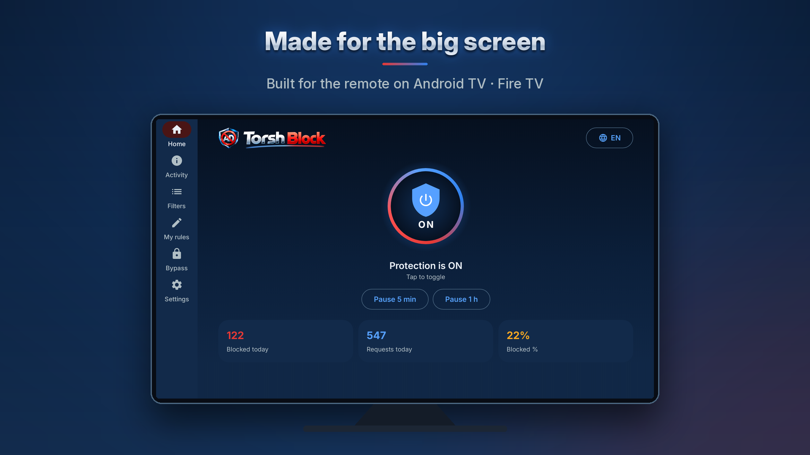</p>

### Download for your phone

Open the download page on your phone and tap “Download for phone”. It picks the right build for your device:

**[torsh.torshblock.workers.dev](https://torsh.torshblock.workers.dev)**

Or get the APK from the [latest release](https://github.com/GF0285/torsh-block/releases/latest).

### Install on Fire TV and Android TV
1. Install **Downloader** from the Amazon Appstore.
2. Allow it to install unknown apps: Settings → My Fire TV → Developer options.
3. Open Downloader, type the code **2966455** (or aftv.news/2966455) and press Go.
4. Install Torsh Block and turn protection on with the remote.

### Support the project

Torsh Block is 100% free and will stay free. To support development, donate **GRAM on the TON network** only:

```
UQDUobwrdGFonu5sWIyyEn7WOwcT-uwuGoKYECwrQq2KdjYR
```

<sub>Proprietary software © 2026 GF0285, free to download and use. See [LICENSE](LICENSE).</sub>

<p align="center"><b>Made with ♥️ by GF0285, member of GeeksFamily and DWM</b></p>

<p align="center"><a href="#top">↑</a></p>

---

<a name="es"></a>
<p align="center">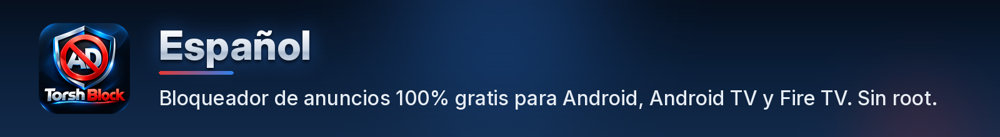</p>

**Torsh Block** es un bloqueador de anuncios 100% gratis para móviles Android, Android TV y Fire TV. Sin root y sin cuenta. Bloquea anuncios y rastreadores en todas las apps y navegadores con una VPN local en tu dispositivo.

### Funciones
- 🛡️ **Protección con un toque** en todas las apps y navegadores.
- 📊 **Estadísticas en vivo:** hoy, últimas 24 horas y últimos 7 días.
- 🌐 **Evita los bloqueos del operador:** DNS cifrado (DoH / DoT) y modo de evasión DPI.
- 📺 **Pensado para la TV:** se maneja por completo con el mando.
- 🗣️ **Cuatro idiomas:** árabe, dariya marroquí, inglés y español.
- 🔄 **Actualizaciones firmadas** desde la app.
- 💯 **100% gratis:** sin anuncios, sin cuenta, sin suscripción.

### Capturas

| | | |
|:-:|:-:|:-:|
| 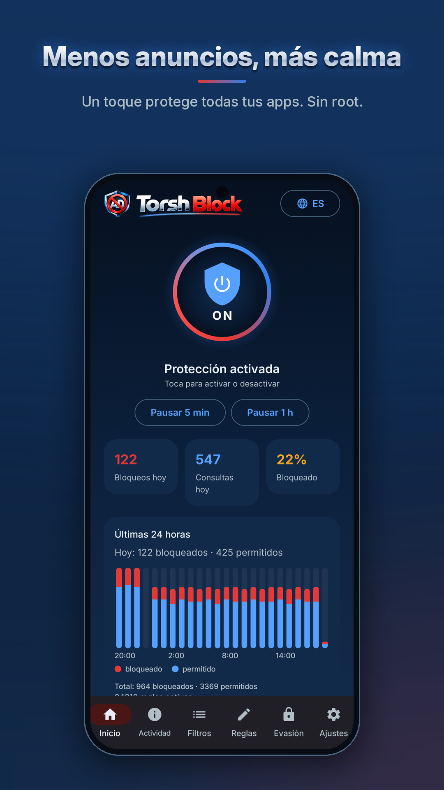 | 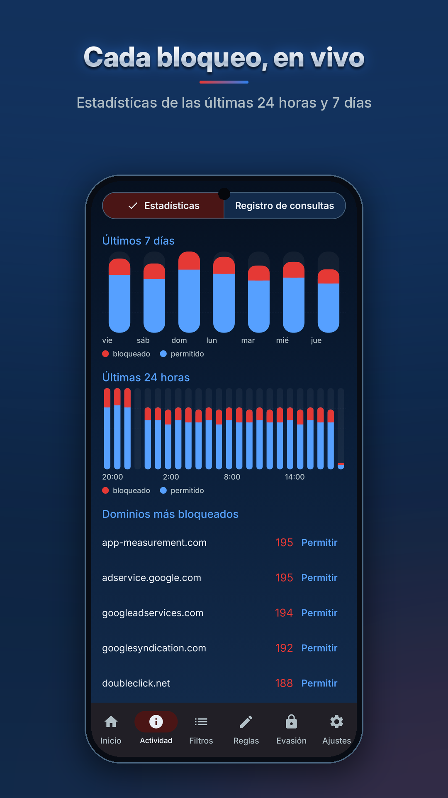 | 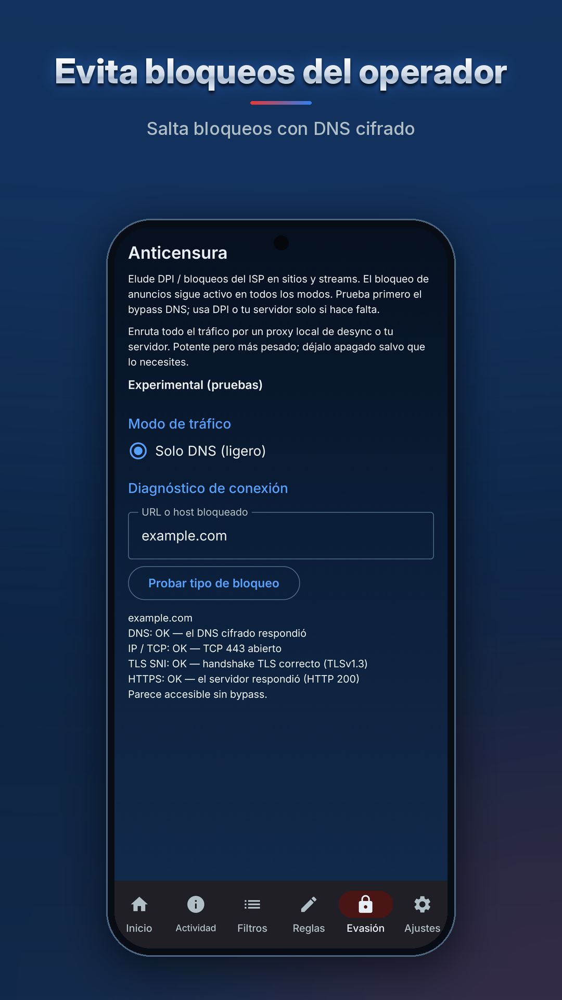 |
| 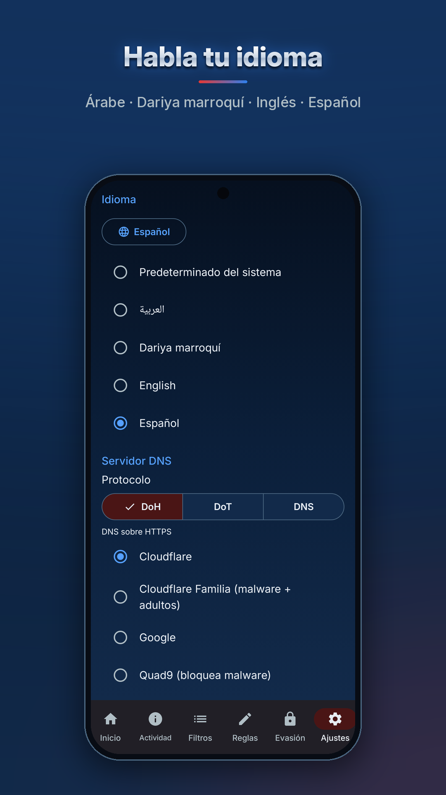 | 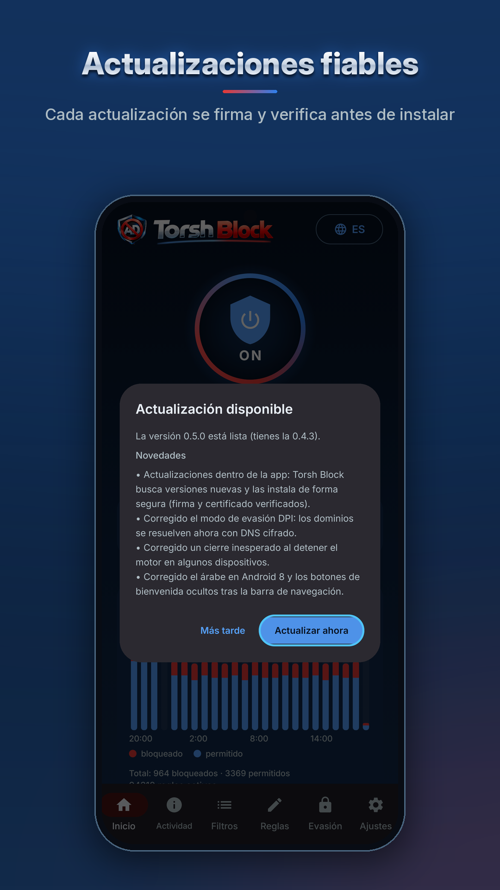 | 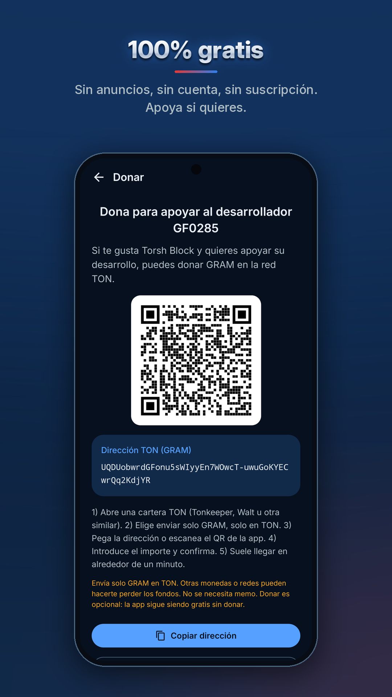 |

<p align="center">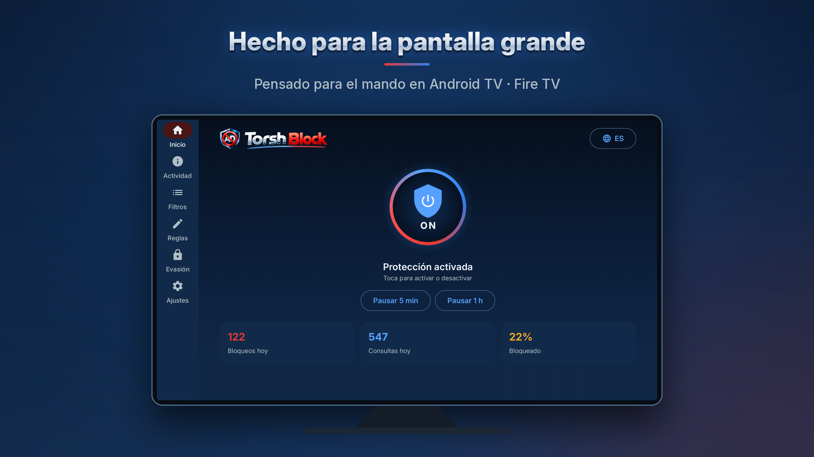</p>

### Descarga en tu móvil

Abre la página de descarga en tu móvil y pulsa «Descargar para móvil». Elige la versión adecuada para tu dispositivo:

**[torsh.torshblock.workers.dev](https://torsh.torshblock.workers.dev)**

O descarga el APK desde la [última versión](https://github.com/GF0285/torsh-block/releases/latest).

### Instalar en Fire TV y Android TV
1. Instala **Downloader** desde la Amazon Appstore.
2. Permite que instale apps desconocidas: Configuración → Mi Fire TV → Opciones para desarrolladores.
3. Abre Downloader, escribe el código **2966455** (o aftv.news/2966455) y pulsa Go.
4. Instala Torsh Block y activa la protección con el mando.

### Apoya el proyecto

Torsh Block es 100% gratis y lo seguirá siendo. Para apoyar el desarrollo, dona **GRAM solo en la red TON**:

```
UQDUobwrdGFonu5sWIyyEn7WOwcT-uwuGoKYECwrQq2KdjYR
```

<sub>Software propietario © 2026 GF0285, gratis para descargar y usar. Consulta [LICENSE](LICENSE).</sub>

<p align="center"><b>Hecho con ♥️ por GF0285, miembro de GeeksFamily y DWM</b></p>

<p align="center"><a href="#top">↑</a></p>

---
